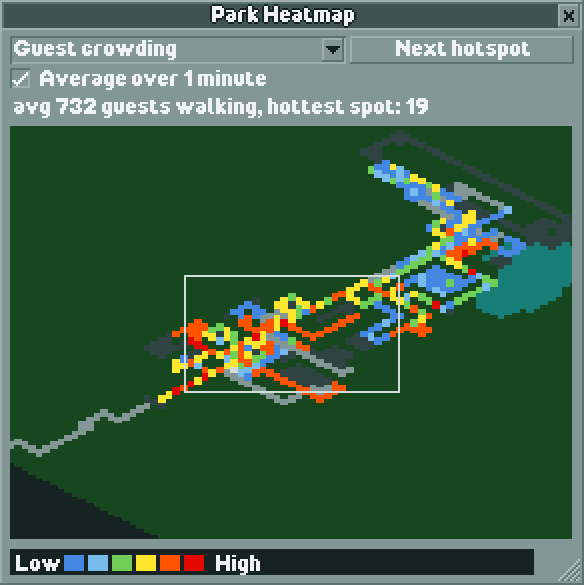
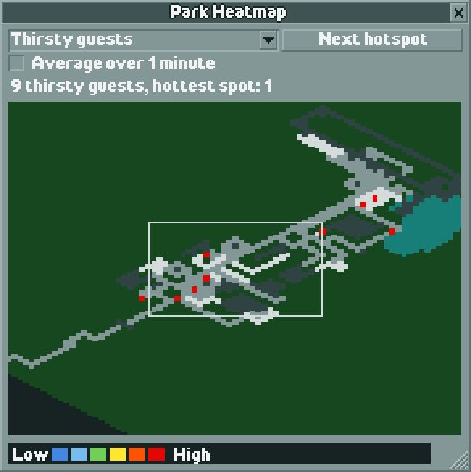

# Park Heatmap

An OpenRCT2 plugin that shows where your park is struggling. It draws a heatmap of the park, from crowded paths and long queues to hungry, sick or lost guests, litter, vandalism, and paths with no bin or bench nearby, so you can see at a glance where to build, hire or fix things.

The heatmap is drawn isometrically like the game's own map, follows the main camera's rotation and zoom, and updates itself as you build.

| Guest crowding, averaged over 1 minute | Thirsty guests |
|---|---|
|  |  |

## Features

- **12 heat layers** covering guest activity and the state of your paths (see [Layers](#layers)).
- **Follows the camera.** The map turns with the camera's rotation, and zooms with the game's six zoom levels: fully zoomed out shows the whole park, zoomed in shows the area around the camera.
- **Camera outline.** A grey rectangle shows the area the main view is looking at.
- **Next hotspot.** Jumps the camera through the 10 hottest areas of the current layer, marking each with a white box.
- **Average over 1 minute.** Shows a moving average of guest activity over the last minute of game time instead of a live snapshot, so busy areas build up and passing guests leave fading trails. The averages run in the background from the moment the park loads, so they're ready as soon as you tick the box.
- **Updates as you build.** Placing or removing paths, track, entrances, land or water updates the map straight away.
- **Remembers your settings.** The selected layer, the averaging choice, and the window's size and position are kept between sessions and across parks.
- **Keyboard shortcut.** Shift+H opens and closes the heatmap.

## Installation

1. Make sure you have **OpenRCT2 v0.5.0 or newer**.
2. Download `park-heatmap.js` from the Releases page of this repository.
3. Put it in the `plugin` folder of your OpenRCT2 user directory:
   - **Windows:** `Documents\OpenRCT2\plugin`
   - **macOS:** `~/Library/Application Support/OpenRCT2/plugin`
   - **Linux:** `~/.config/OpenRCT2/plugin` (or `$XDG_CONFIG_HOME/OpenRCT2/plugin`)

   You can also open the user directory from the game: the red toolbox on the title screen, then **Open custom content folder**.
4. Start (or restart) OpenRCT2.

## Usage

Load a park, then open the heatmap from the **map menu** in the top toolbar (**Park Heatmap**), or press **Shift+H**. Press Shift+H again to close it.

- **Layer dropdown:** choose what the heat shows.
- **Next hotspot:** moves the camera to the next of the 10 hottest areas.
- **Average over 1 minute:** switches guest layers between a live snapshot and a one-minute moving average. It's greyed out for map layers, which always show the current state.
- **Status line:** the total for the layer (for example, "23 lost guests") and the hottest spot's value.
- **Resize** the window from its bottom-right corner; the map scales to fit.

Colours run from blue (low) through green, yellow and orange to red (high), relative to the hottest spot on the map. The base map shows land outside the park in black, park land in dark green, water in blue, paths and queues in grey, and rides in dark grey.

### Changing the shortcut

Go to **Options → Controls → Shortcut keys**, open the last tab (the wrench icon), and scroll to **Toggle Park Heatmap** at the bottom. This works from the title screen too.

## Layers

The need thresholds match the points at which the game itself makes guests think about that need.

| Layer | What gets heat |
|---|---|
| Guest crowding | Every guest walking in the park |
| Queue crowding | Guests standing in queue lines |
| Unhappy guests | Guests with happiness below 96 (out of 255) |
| Hungry guests | Hunger 10 or below, and not carrying food or drink |
| Thirsty guests | Thirst 25 or below, and not carrying food or drink |
| Need a toilet | Toilet need 160 or above |
| Feeling sick | Nausea 140 or above; very sick guests (200 or above, who head for first aid) count double |
| Lost guests | Guests the game marks as lost |
| Vandalism | Broken bins, benches and lamps on paths |
| Far from a bin | Path tiles more than 6 tiles' walk from a working bin; hotter the further away |
| Far from a bench | Path tiles more than 8 tiles' walk from a working bench; hotter the further away |
| Litter & vomit | Litter on the ground; vomit counts double |

**Why bin distance matters:** guests don't look for bins. A guest carrying trash only uses a bin if they walk onto its tile, and otherwise eventually drops it wherever they are. Broken bins don't count, so vandalism leads straight to litter. That's why these layers measure walking distance along paths to the nearest *working* bin or bench.

**Map layers** (Vandalism, Far from a bin, Far from a bench) show the state of your paths rather than guest activity, so they're never averaged: a repaired bench disappears from the map immediately.

## Known limitations

- **Guests on rides** aren't on any map tile, so they don't appear on guest layers. The guest count will be lower than the park's total.
- **Custom path items:** the plugin API doesn't say whether a path item is a bin or a bench, so the plugin recognises them by object name. All vanilla bins and benches are recognised; custom objects with unusual names may not be.
- **Heights:** the heatmap is drawn flat. Paths at different heights on neighbouring tiles count as connected for bin and bench distances, and on hilly terrain the camera outline's edges can sit slightly off (its centre stays accurate).
- **Clicking the map** doesn't move the camera: the plugin API doesn't report where the mouse is on a custom drawing. Use **Next hotspot** instead.

## Development

The plugin is written in TypeScript and bundled with Rollup. It was started from [OpenRCT2-Simple-Typescript-Template](https://github.com/Basssiiie/OpenRCT2-Simple-Typescript-Template).

### Setup

1. Install [Node.js](https://nodejs.org/) (LTS), for example with [nvm](https://github.com/nvm-sh/nvm): `nvm install --lts`.
2. Run `npm install` in this folder.

### Commands

| Command | What it does |
|---|---|
| `npm start` | Rebuilds a readable development build into your OpenRCT2 plugin folder every time a file in `src/` changes. |
| `npm run build:dev` | Makes one development build into your OpenRCT2 plugin folder. |
| `npm run build` | Makes a minified release build at `dist/park-heatmap.js`. |

For **hot reload**, set `enable_hot_reloading = true` in OpenRCT2's `config.ini`, run `npm start`, and load a park: the game reloads the plugin whenever the build changes. A change to the plugin's type or keyboard shortcut needs a full game restart.

### Code layout

| File | Contents |
|---|---|
| `src/plugin.ts` | Plugin registration (name, version, type, API version). |
| `src/startup.ts` | Registers the menu item and shortcut, and resets the heat model on each park load. |
| `src/heatmap/heatModel.ts` | Background model: keeps the map scan current and the moving averages warm. |
| `src/heatmap/layers.ts` | Layer definitions and the shared pass over guests. |
| `src/heatmap/pathLayers.ts` | Vandalism and bin/bench distance layers. |
| `src/heatmap/mapScan.ts` | Scans tiles into the base map (land, water, paths, queues, rides) and the park's bounds. |
| `src/heatmap/mapWatcher.ts` | Turns building actions into areas of the map to rescan. |
| `src/heatmap/window.ts` | The heatmap window: layout, isometric drawing, camera tracking, hotspots. |
| `src/heatmap/settings.ts` | Saved settings (layer, averaging, window size and position). |
| `src/heatmap/palette.ts` | Palette colours for the base map, heat ramp and outlines. |

The plugin is `intransient`, so it starts when the game launches (letting the shortcut be rebound from the title screen) and keeps running across park loads. The heatmap itself only works in a played park.

## License

[MIT](LICENSE)
